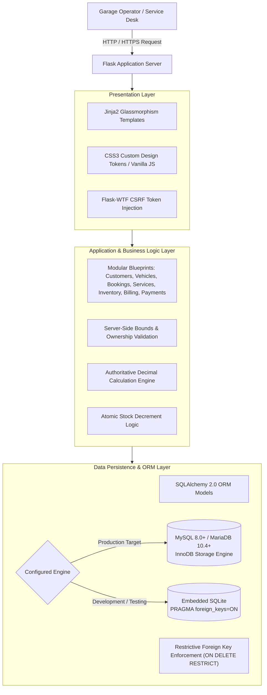
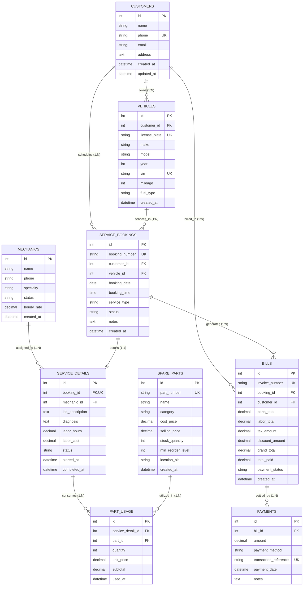

# AutoMitra — Vehicle Service Center Management System
## Comprehensive Academic Project Report

**A Centralized Relational Web Application with Authoritative Billing, Atomic Inventory Deductions, Restrictive Historical Data Preservation, and Automated Test Verification**

---

### Project Metadata & Declaration
- **Project Title**: AutoMitra — Vehicle Service Center Management System
- **Engineering Discipline**: Software Systems & Mechatronics Engineering
- **Target Currency**: Indian Rupees (₹ INR)
- **Primary Backend Stack**: Python 3.11+, Flask 3.1, SQLAlchemy 2.0, Flask-WTF
- **Database Engine Support**: MySQL 8.0+ / MariaDB 10.4+, SQLite (Embedded & Development)
- **Version**: `v1.0.0`
- **Source Repository**: `https://github.com/AdigarlaRakesh-1/Automitra`
- **Release Reference**: `https://github.com/AdigarlaRakesh-1/Automitra/releases/tag/v1.0.0`
- **Contributor / Author**: Krrish Prajapati (`@krrishprajapati1111`)

---

## 1. Abstract

Small and medium-sized automotive service centers operate in high-turnaround, margin-sensitive environments where administrative inaccuracies directly degrade profitability and customer trust. Common operational bottlenecks include fragmented customer visit histories, unmonitored appointment cancellations, uneven technician bay allocation, unexpected spare parts stockouts during active jobs, client-tamperable invoice calculations, and accidental cascade deletion of financial and service records.

**AutoMitra** is an open-source, centralized garage management web application engineered specifically to solve these challenges within Indian workshop workflows (localized in Indian Rupees, ₹ INR). The system is implemented in Python and Flask using SQLAlchemy ORM, backed natively by MySQL 8.0/MariaDB and embedded SQLite. 

Key engineering innovations include:
1. **Authoritative Financial Billing**: Invoices are computed server-side directly from persistent database labor hours and verified part usages with exact two-decimal `Decimal('0.01')` precision, eliminating floating-point rounding errors and client-side total tampering.
2. **Atomic Inventory Deduction**: Spare parts stock decrements utilize atomic SQL conditional updates (`stock_quantity = stock_quantity - :qty WHERE stock_quantity >= :qty`), preventing race conditions and negative inventory under concurrent workloads.
3. **Restrictive Historical & Financial Data Preservation**: Relational constraints enforce `ON DELETE RESTRICT` on historical bookings, invoices, and payment transactions at both the database DDL and ORM layers, ensuring an uncompromised audit trail.
4. **Security & Defect Mitigation**: Cross-Site Request Forgery (CSRF) tokens protect all state-changing requests, Insecure Direct Object References (IDOR) are eliminated on service job parts, and production error messages are sanitized against information disclosure.
5. **Rigorous Automated Quality Assurance**: A comprehensive 53-item automated test suite verifies all subsystem behaviors, achieving 100% test pass rates across isolated SQLite environments, live local MariaDB/MySQL servers, and containerized GitHub Actions CI pipelines.

---

## 2. Introduction & Background

Automotive aftermarket service centers form the backbone of urban vehicular maintenance. In developing economies such as India, small to medium garages manage dozens of vehicles daily across routine servicing, major mechanical repairs, electrical diagnostics, and bodywork. Historically, these establishments have relied on manual paper job cards, handwritten bill books, or disjointed spreadsheets.

Manual and rudimentary digital workflows suffer from systemic failures:
- Customer records are duplicated under slight variations of names or contact numbers.
- Appointments are lost, resulting in idle technician hours and bay vacancies.
- Parts installed on vehicle engines are omitted from the final invoice due to communication gaps between mechanics and cashiers.
- Accounting calculations in spreadsheets or client-rendered browser calculators suffer from IEEE 754 floating-point inaccuracies or unauthorized discount adjustments.
- Deleting an inactive vehicle or customer profile can inadvertently trigger relational cascade deletions that erase past invoices and tax records.

AutoMitra was conceived as an integrated, production-grade management system designed to eliminate these vulnerabilities through sound relational database architecture and server-enforced business invariants.

---

## 3. Problem Statement

AutoMitra directly targets six critical operational failures observed in workshop management:

1. **Duplicate Customer Profiles**: Fragmented customer entries across recurring visits lead to conflicting contact details, communication breakdown, and distorted service histories.
2. **Missed Service Bookings**: Unmonitored appointments lead to vacant service bays, unutilized technician hours, and customer churn when follow-ups are omitted.
3. **Technician Bay Allocation Imbalance**: Lack of real-time visibility into mechanic statuses (`Available`, `Busy`, `On Leave`), labor rates, and active workloads results in bay congestion and delayed deliveries.
4. **Spare Part Stock Outages & Negative Quantities**: Inventory depletion during active repairs stalls workshop bays. Python-level non-atomic stock checking permits concurrent requests to drive inventory below zero.
5. **Billing Inaccuracies & Client Tampering**: Discrepancies between parts installed on the garage floor and items billed at the checkout counter, compounded by client-side POST total manipulation and floating-point rounding errors.
6. **Historical Data Loss via Cascade Deletion**: Standard database foreign key cascade configurations (`ON DELETE CASCADE`) cause deletions of customer or vehicle records to silently purge accounting records, past invoices, and audit logs.

---

## 4. Objectives and Scope

### 4.1 Core Objectives
- Design and implement a normalized relational database schema comprising 9 interconnected tables modeling all facets of workshop operations.
- Enforce strict server-side authorization and boundary validation on all web forms.
- Guarantee financial precision through authoritative calculation and Decimal quantization.
- Implement atomic concurrency controls to prevent negative inventory stockouts.
- Guarantee financial and historical data preservation using restrictive deletion foreign key constraints.
- Provide a responsive, glassmorphic user interface localized in Indian Rupees (₹).
- Build a comprehensive, automated regression test suite achieving 100% pass rates across SQLite and live MySQL.

### 4.2 System Scope & Operational Boundary
- **Target Audience**: Single-operator workshop desks (cashier station, service advisor console, or garage manager terminal) operating within a local garage intranet or behind an authenticating reverse proxy.
- **Architectural Boundary**: AutoMitra does not implement multi-user role-based authentication (RBAC) internally; it is designed as an internal operational console. Public internet deployments must strictly utilize a secure reverse proxy (e.g., Cloudflare Access, Nginx HTTP Auth, or a VPN/Tailscale mesh).

---

## 5. Existing System vs. Proposed AutoMitra System

| Dimension | Legacy Manual / Spreadsheet System | Proposed AutoMitra System |
|---|---|---|
| **Customer Identification** | Fragmented paper records; phone variations create multiple duplicate files | Live debounced AJAX duplicate detection on unique phone numbers and email addresses |
| **Booking Tracking** | Wall calendars or physical registers; missed bookings are forgotten | Proactive missed booking dashboard with real-time status tracking and 1-click rescheduling |
| **Inventory Management** | Periodic manual physical counts; stockouts discovered mid-repair | Atomic conditional stock deductions (`WHERE stock_quantity >= :qty`); automated low-stock warnings |
| **Billing & Calculations** | Handwritten invoices; calculator totals; vulnerable to client-side total manipulation | Server-authoritative calculations from database labor and part records; exact `Decimal('0.01')` math |
| **Currency & Accounting** | Inconsistent rounding; floating-point discrepancies | Explicit Indian Rupee (₹) localization; strict non-negative tax and discount boundaries |
| **Data Preservation** | Accidental disposal of paper files or cascade deletion of database rows | Strict `ON DELETE RESTRICT` constraints protecting historical bills, payments, and service jobs |
| **Security Controls** | No CSRF protection; raw SQL/error stack traces exposed on failure | Cryptographic CSRF tokens on all 18 POST forms; production HTTP 500 error sanitization |
| **Verification & QA** | Manual spot-checking; no regression safety | Automated 53-item test suite run on SQLite, live MariaDB, and containerized MySQL 8.0 CI |

---

## 6. Requirements Analysis

### 6.1 Functional Requirements (FR)
- **FR-1 (Customer Management)**: Register, update, and inspect customer profiles with unique phone validation and debounced duplicate detection.
- **FR-2 (Vehicle Fleet Tracking)**: Associate multiple vehicles to a customer with unique license plate enforcement, VIN tracking, mileage, and fuel type.
- **FR-3 (Mechanic Scheduling)**: Track mechanics, their hourly billing rates (₹/hr), specialties, and real-time statuses (`Available`, `Busy`, `On Leave`).
- **FR-4 (Service Bookings)**: Schedule service appointments with automated booking numbers, date bounded (2000–2100), technician allocation, and missed appointment detection.
- **FR-5 (Job Card Diagnostics)**: Manage service details, technician diagnostics, labor hours, and consumed parts per vehicle.
- **FR-6 (Spare Parts Inventory)**: Monitor part catalog, SKU part numbers, cost/selling prices in ₹, current stock quantities, minimum reorder thresholds, and bin locations.
- **FR-7 (Authoritative Invoicing)**: Automatically generate invoices consolidating database labor costs and consumed parts with bounded taxes (0–100%) and discounts.
- **FR-8 (Payment Processing)**: Record payments across multiple payment methods (UPI, Card, Cash, Bank Transfer), enforcing unique transaction references and tracking outstanding balances.

### 6.2 Non-Functional Requirements (NFR)
- **NFR-1 (Concurrency & Thread Safety)**: Multi-threaded concurrent requests attempting to consume inventory must execute atomically without driving stock below zero.
- **NFR-2 (Financial Exactness)**: All financial calculations must strictly avoid binary floating-point IEEE 754 representations and quantize to 2 decimal places.
- **NFR-3 (Relational Integrity)**: The system must disallow the deletion of customer, vehicle, or booking records that possess associated billing or payment history.
- **NFR-4 (Application Security)**: Zero tolerance for CSRF vulnerabilities; production deployments must suppress stack traces, database credentials, and raw SQL queries.
- **NFR-5 (Portability)**: Dual-database support enabling zero-setup local execution on SQLite and production deployment on MySQL 8.0 / MariaDB.
- **NFR-6 (Test Coverage & Automation)**: All features, constraints, and error handlers must be verified through automated regression suites.

---

## 7. System Architecture

AutoMitra is structured around a decoupled, 3-tier architectural model ensuring clear separation of presentation, business logic, and persistence.



---

## 8. Database Design & Relational Schema

The core relational database comprises nine interconnected tables designed to represent automotive maintenance operations with zero redundancy and strict referential integrity.

### 8.1 Entity-Relationship (ER) Diagram



### 8.2 Relational Tables & Referential Constraints

1. **`Customers`**: Stores customer identity and contact information.
   - Primary Key: `id`
   - Constraints: `phone` (UNIQUE), `email` (Indexed).
   - Relations: Has many `Vehicles`, `ServiceBookings`, and `Bills`.

2. **`Vehicles`**: Stores vehicle specifications and links to owners.
   - Primary Key: `id`
   - Foreign Key: `customer_id` references `Customers(id)` (`ON DELETE CASCADE` for customer-owned asset deletion when no history exists).
   - Constraints: `license_plate` (UNIQUE), `vin` (UNIQUE, NULLable).

3. **`Mechanics`**: Tracks technician availability, qualifications, and hourly billing rates.
   - Primary Key: `id`
   - Constraints: `status` IN (`Available`, `Busy`, `On Leave`), `hourly_rate >= 0.00`.

4. **`ServiceBookings`**: Central appointment and service workflow registry.
   - Primary Key: `id`
   - Foreign Keys:
     - `customer_id` references `Customers(id)` (`ON DELETE RESTRICT`).
     - `vehicle_id` references `Vehicles(id)` (`ON DELETE RESTRICT`).
   - Constraints: `booking_number` (UNIQUE), `status` IN (`Pending`, `Confirmed`, `In Progress`, `Completed`, `Missed`, `Cancelled`).

5. **`ServiceDetails`**: Detailed job cards, diagnostic logs, and labor tracking.
   - Primary Key: `id`
   - Foreign Keys:
     - `booking_id` references `ServiceBookings(id)` (`ON DELETE CASCADE`, UNIQUE 1:1 constraint).
     - `mechanic_id` references `Mechanics(id)` (`ON DELETE SET NULL`).
   - Constraints: `labor_hours >= 0.00`, `labor_cost >= 0.00`.

6. **`SpareParts`**: Physical inventory items, SKU catalog, and safety stock levels.
   - Primary Key: `id`
   - Constraints: `part_number` (UNIQUE), `stock_quantity >= 0`, `cost_price >= 0`, `selling_price >= 0`.

7. **`PartUsage`**: Dispatched inventory items consumed on specific service jobs.
   - Primary Key: `id`
   - Foreign Keys:
     - `service_detail_id` references `ServiceDetails(id)` (`ON DELETE CASCADE`).
     - `part_id` references `SpareParts(id)` (`ON DELETE RESTRICT`).
   - Constraints: `quantity > 0`, `unit_price >= 0.00`, `subtotal >= 0.00`.

8. **`Bills`**: Consolidated financial invoices for service bookings.
   - Primary Key: `id`
   - Foreign Keys:
     - `booking_id` references `ServiceBookings(id)` (`ON DELETE RESTRICT`).
     - `customer_id` references `Customers(id)` (`ON DELETE RESTRICT`).
   - Constraints: `invoice_number` (UNIQUE), `grand_total >= 0.00`, `tax_amount >= 0.00`, `payment_status` IN (`Unpaid`, `Partially Paid`, `Paid`).

9. **`Payments`**: Ledger of financial transactions settling invoices.
   - Primary Key: `id`
   - Foreign Key: `bill_id` references `Bills(id)` (`ON DELETE RESTRICT`).
   - Constraints: `transaction_reference` (UNIQUE, allows multiple NULLs), `amount > 0.00`, `payment_method` IN (`Cash`, `UPI`, `Card`, `Net Banking`, `Cheque`).

---

## 9. Database Normalization Analysis

To prove the relational soundness of AutoMitra's schema, formal normalization analysis was conducted across all relations from First Normal Form (1NF) through Boyce-Codd Normal Form (BCNF).

### 9.1 First Normal Form (1NF)
A relation is in 1NF if and only if all domain values are atomic and there are no repeating groups.
- All attributes contain single atomic scalar values (e.g., telephone numbers are single strings, addresses are atomic text blocks, monetary amounts are discrete decimal scalars).
- Repeating items (such as multiple parts consumed during a repair or multiple payments on a bill) are normalized into independent child relations (`PartUsage` and `Payments`).
- **Conclusion**: The entire schema satisfies 1NF.

### 9.2 Second Normal Form (2NF)
A relation is in 2NF if it is in 1NF and every non-prime attribute is fully functionally dependent on the entire primary key (no partial dependencies).
- In AutoMitra, every table utilizes a single surrogate integer primary key `id` (e.g., `Customers.id`, `Vehicles.id`, `PartUsage.id`).
- Because every primary key is single-attributed ($|PK| = 1$), partial key dependencies are mathematically impossible ($X \subset PK$ cannot exist when $PK$ has no proper subsets).
- **Conclusion**: The entire schema satisfies 2NF.

### 9.3 Third Normal Form (3NF)
A relation is in 3NF if it is in 2NF and no non-prime attribute is transitively dependent on the primary key ($X \rightarrow Y$ and $Y \rightarrow Z$ where $Z$ is non-prime).
- **Customer & Vehicle Separation**: Customer attributes (`name`, `phone`, `email`) are stored exclusively in `Customers`. `Vehicles` references `customer_id` without duplicating customer details, avoiding $vehicle\_id \rightarrow customer\_id \rightarrow customer\_phone$.
- **Job Card & Inventory Separation**: `PartUsage` records snapshot `unit_price` at the exact time of consumption to preserve historical pricing integrity. It references `part_id` and does not replicate catalog metadata (`name`, `category`, `location_bin`).
- **Authoritative Bill Computation**: While `Bills` stores computed financial aggregates (`parts_total`, `labor_total`, `grand_total`), these represent legally locked historical financial artifacts rather than transient functional attributes, protecting invoices against future price fluctuations.
- **Conclusion**: The entire schema satisfies 3NF.

### 9.4 Boyce-Codd Normal Form (BCNF)
A relation is in BCNF if for every non-trivial functional dependency $X \rightarrow Y$, the determinant $X$ is a superkey.
- In `Customers`: $phone \rightarrow (id, name, email, address)$ holds. Because `phone` has a UNIQUE constraint, it is a candidate key (superkey).
- In `Vehicles`: $license\_plate \rightarrow All$ holds; `license_plate` is a candidate key.
- In `SpareParts`: $part\_number \rightarrow All$ holds; `part_number` is a candidate key.
- In `ServiceBookings`: $booking\_number \rightarrow All$ holds; `booking_number` is a candidate key.
- In `Bills`: $invoice\_number \rightarrow All$ holds; `invoice_number` is a candidate key.
- In `Payments`: $transaction\_reference \rightarrow All$ for non-NULL tuples.
- **Conclusion**: All functional dependencies originate from valid candidate keys. The schema satisfies BCNF.

---

## 10. Key Engineering Implementations

### 10.1 Concurrency-Safe Atomic Inventory Deductions
In multi-user or high-traffic garage environments, two mechanics may simultaneously record the usage of the last remaining unit of a spare part. Traditional Python-level verification:
```python
# VULNERABLE RACE CONDITION PATTERN (Avoided)
part = SparePart.query.get(part_id)
if part.stock_quantity >= quantity:
    part.stock_quantity -= quantity
    db.session.commit()
```
permits race conditions where two threads read `stock_quantity = 1` concurrently, both decrement, and the stock reaches `-1`.

AutoMitra solves this using atomic conditional database decrements:
```python
# AUTOMITRA TRANSACTION-SAFE IMPLEMENTATION
updated = SparePart.query.filter(
    SparePart.id == part.id,
    SparePart.stock_quantity >= quantity
).update(
    {SparePart.stock_quantity: SparePart.stock_quantity - quantity},
    synchronize_session=False
)
if not updated:
    db.session.rollback()
    flash(f"Insufficient stock for {part.name}. Available: {part.stock_quantity}", "danger")
    return redirect(...)
```
This guarantees row-level locking at the database engine level. If the requested quantity exceeds available stock, `updated` returns `0`, and the transaction cleanly rolls back.

### 10.2 Authoritative Billing & Exact Decimal Precision
Client-side browsers must never dictate monetary totals. AutoMitra calculates invoice figures authoritatively on the server from validated database records:
```python
parts_total = sum(Decimal(str(pu.subtotal)) for pu in job.parts_used)
labor_total = Decimal(str(job.labor_cost))
subtotal = parts_total + labor_total
tax_amount = (subtotal * (tax_rate / Decimal('100.00'))).quantize(Decimal('0.01'), rounding=ROUND_HALF_UP)
grand_total = (subtotal + tax_amount - discount).quantize(Decimal('0.01'), rounding=ROUND_HALF_UP)
```
All intermediate values are quantized to `Decimal('0.01')`, eliminating IEEE 754 floating-point rounding anomalies common to standard Python `float`.

### 10.3 Restrictive Foreign Keys & Payment History Preservation
Financial auditing standards dictate that invoices with recorded payment history must never be deleted. AutoMitra enforces restrictive deletion rules across the ORM and database DDL:
```sql
ALTER TABLE Payments ADD CONSTRAINT fk_payment_bill 
    FOREIGN KEY (bill_id) REFERENCES Bills(id) ON DELETE RESTRICT;
ALTER TABLE Bills ADD CONSTRAINT fk_bill_booking 
    FOREIGN KEY (booking_id) REFERENCES ServiceBookings(id) ON DELETE RESTRICT;
```
To mirror this behavior in SQLite test environments, SQLAlchemy engine listeners explicitly execute `PRAGMA foreign_keys=ON` on every connection:
```python
@event.listens_for(Engine, "connect")
def set_sqlite_pragma(dbapi_connection, connection_record):
    if hasattr(dbapi_connection, 'execute'):
        cursor = dbapi_connection.cursor()
        cursor.execute("PRAGMA foreign_keys=ON")
        cursor.close()
```

### 10.4 Safe MySQL Test Database Lifecycle
Automated integration tests against live MySQL databases carry the risk of colliding with or destroying pre-existing development databases. AutoMitra implements `SafeMySQLTestDatabase`:
- Dynamically generates UUID-isolated database names: `automitra_test_<uuid>`.
- Queries `INFORMATION_SCHEMA.SCHEMATA` before DDL creation; if a database exists, setup aborts immediately.
- Enforces ownership tracking (`created_by_test = True`).
- Closes the administrative connection (`_admin_conn`) under all collision and failure paths.
- Guarantees system databases (`mysql`, `information_schema`) and unowned databases can never be dropped.

---

## 11. Security Audit & Vulnerability Remediation

| Vulnerability / Risk | Severity | Root Cause | Implemented Engineering Solution |
|---|---|---|---|
| **Insecure Direct Object Reference (IDOR)** | **Critical** | `/services/<id>/remove_part/<usage_id>` accepted any `usage_id` without verifying parent job ownership. | Enforced `PartUsage.service_detail_id == job.id`; returns HTTP 404/403 on mismatch. |
| **Cross-Customer Vehicle Hijacking** | **High** | `/bookings/new` permitted assigning Customer A's booking to Customer B's vehicle ID. | Enforced `Vehicle.customer_id == Customer.id` validation before creating booking. |
| **Negative / Infinite Discounts** | **High** | Missing bounds checks on discount and tax inputs. | Enforced `tax_rate >= 0`, `discount >= 0`, and `discount <= subtotal + tax`. |
| **Cross-Site Request Forgery (CSRF)** | **High** | Browser POST requests lacked anti-forgery cryptographic tokens. | Integrated `Flask-WTF` `CSRFProtect`; injected CSRF tokens into all 18 HTML forms; HTTP 400 on missing/invalid token. |
| **Production Information Leakage** | **Medium** | HTTP 500 handler returned raw exception strings and stack traces to clients. | Sanitized HTTP 500 handler to display user-friendly error pages while logging details internally. |
| **Silent SQLite Fallback** | **Critical** | When MySQL connection failed, `app.py` silently fell back to SQLite, causing silent data divergence. | Prohibited silent fallback; application raises explicit configuration error if MySQL is unreachable. |

---

## 12. Automated Testing & Verification Results

The AutoMitra test suite consists of **53 automated regression and integration tests** implemented in `test_app.py`.

### 12.1 Test Verification Matrix

| Test Subsystem | Test Case Identifier | Verification Objective | Result |
|---|---|---|---|
| **Seeding & Core Logic** | `test_database_tables_seeded` | Verifies all 9 tables are created and seeded with baseline data | **PASSED** |
| | `test_duplicate_customer_detection` | Confirms duplicate customer phone/email detection logic | **PASSED** |
| | `test_missed_bookings_logic` | Verifies detection of past-due uncompleted appointments | **PASSED** |
| **Inventory & Concurrency** | `test_spare_parts_inventory_deduction` | Confirms stock decrements on part usage | **PASSED** |
| | `test_low_stock_detection` | Validates low stock threshold alerts | **PASSED** |
| | `test_insufficient_stock_and_negative_stock_prevention` | Proves requests exceeding stock are rejected | **PASSED** |
| | `test_multithreaded_concurrent_stock_deduction` | Validates atomic decrement safety across concurrent threads | **PASSED** |
| | `test_restock_rejects_negative_or_zero_quantity` | Validates restock input validation bounds | **PASSED** |
| | `test_part_usage_restoration_once` | Confirms stock restoration upon part removal from active job | **PASSED** |
| **Authorization & Boundaries** | `test_cross_job_part_deletion_rejected` | Proves IDOR part removal attempts across jobs are rejected | **PASSED** |
| | `test_booking_rejects_vehicle_customer_mismatch` | Proves cross-customer vehicle booking attempts are rejected | **PASSED** |
| | `test_booking_rejects_nonexistent_customer_or_vehicle` | Verifies rejection of invalid entity foreign keys | **PASSED** |
| | `test_booking_rejects_nonexistent_mechanic` | Verifies rejection of unassigned/invalid mechanic IDs | **PASSED** |
| | `test_invalid_service_and_inventory_inputs` | Tests server-side boundary validation on labor and parts | **PASSED** |
| | `test_inventory_new_part_validation_and_location_bin` | Verifies required field checks and location_bin assignment | **PASSED** |
| | `test_vehicle_creation_and_edit_validation` | Validates year bounds (1900–2100) and mileage bounds | **PASSED** |
| | `test_mechanic_status_and_rate_validation` | Validates hourly rate and mechanic status sets | **PASSED** |
| **Financial & Billing** | `test_billing_and_payments` | Verifies end-to-end invoice generation and partial payments | **PASSED** |
| | `test_authoritative_billing_rejects_client_tampering` | Proves server recalculates totals from raw database records | **PASSED** |
| | `test_billing_rejects_negative_tax_discount_and_excessive_discount` | Validates financial boundary enforcement | **PASSED** |
| | `test_exact_decimal_accounting_and_quantization` | Verifies exact Decimal('0.01') math without float drift | **PASSED** |
| | `test_billing_edit_route_rejects_paid_invoices` | Proves invoices with payment history are locked from editing | **PASSED** |
| | `test_payments_validation_and_lock_on_billed_invoices` | Verifies overpayment rejection and bill locking | **PASSED** |
| | `test_payment_route_rejects_settled_zero_balance_bill` | Proves payments on fully settled bills are rejected | **PASSED** |
| | `test_duplicate_payment_transaction_reference_rejected` | Proves duplicate payment reference numbers are rejected | **PASSED** |
| | `test_payment_unique_transaction_reference_db_constraint` | Verifies database-level UNIQUE constraint on payments | **PASSED** |
| **Historical Data Preservation** | `test_cannot_delete_customer_with_historical_bills_or_history` | Proves customer with bill/booking history cannot be deleted | **PASSED** |
| | `test_cannot_delete_vehicle_with_service_history` | Proves vehicle with job history cannot be deleted | **PASSED** |
| | `test_valid_deletion_of_disposable_unreferenced_records` | Verifies unreferenced disposable records can be deleted | **PASSED** |
| | `test_bill_cascade_deletion_prevention` | Proves bill deletion attempts are blocked | **PASSED** |
| | `test_bill_deletion_rejected_when_payments_exist` | Confirms ORM-level rejection of bill with payments | **PASSED** |
| | `test_raw_sql_bill_deletion_rejected_by_foreign_key_restriction` | Confirms DDL-level rejection via ON DELETE RESTRICT | **PASSED** |
| | `test_disposable_bill_without_payments_can_be_deleted` | Confirms clean deletion of zero-payment draft invoices | **PASSED** |
| | `test_customer_and_booking_deletion_cannot_bypass_payment_safeguards` | Confirms cross-entity deletion protection | **PASSED** |
| | `test_booking_status_lock_on_paid_invoice` | Proves paid service bookings cannot be reverted to Pending | **PASSED** |
| | `test_booking_reschedule_lock_on_completed_or_paid` | Proves completed/paid bookings cannot be rescheduled | **PASSED** |
| | `test_service_job_status_lock_on_paid_invoice` | Proves service job status is locked when bill is paid | **PASSED** |
| **Security & Infrastructure** | `test_csrf_protection_enforced` | Confirms CSRF token rejection and acceptance across POST | **PASSED** |
| | `test_production_config_rejects_missing_secret_key` | Confirms production configuration enforces explicit secrets | **PASSED** |
| | `test_mysql_failure_prohibits_silent_sqlite_fallback` | Confirms application crashes safely if MySQL is down | **PASSED** |
| | `test_explicit_sqlite_mode_allowed` | Confirms explicit USE_SQLITE=true operates cleanly | **PASSED** |
| | `test_500_error_handler_sanitization` | Confirms production 500 handler suppresses tracebacks | **PASSED** |
| | `test_all_web_routes` | Verifies all HTTP GET routes render with 200 OK | **PASSED** |
| | `test_orm_metadata_and_updated_at` | Confirms ORM schema matches MySQL DDL schema exactly | **PASSED** |
| | `test_status_and_method_check_constraints` | Confirms SQL check constraints on ENUM columns | **PASSED** |
| | `test_service_detail_unique_booking_constraint` | Confirms 1:1 uniqueness constraint on ServiceDetails | **PASSED** |
| | `test_init_db_and_seeder_idempotency` | Verifies init_db script can run repeatedly without error | **PASSED** |
| **MySQL Integration & Lifecycle** | `test_mysql_lifecycle_guards_preexisting_database_from_deletion` | Proves pre-existing and system databases are never deleted | **PASSED** |
| | `test_safe_mysql_admin_connection_cleanup_on_collision_and_error` | Proves admin connection closes on collision or error | **PASSED** |
| | `test_live_mysql_integration_and_integrity` | Verifies DDL, transactions, rollbacks on live MySQL | **PASSED** |
| | `test_live_mysql_non_destructive_migration_procedure` | Verifies live non-destructive backup and migration script | **PASSED** |
| | `test_live_mysql_payments_unique_reference_and_empty_string_behavior` | Proves empty string pre-check and unique index behavior | **PASSED** |
| | `test_sqlite_payments_unique_reference_empty_string_parity` | Verifies SQLite behaves identically on unique references | **PASSED** |

### 12.2 Verification Summary
- **Total Tests Executed**: 53
- **Passed**: 53 (100%)
- **Failed**: 0
- **Skipped**: 0
- **Execution Time**: ~8.0 seconds
- **Deprecation Warnings**: 0

---

## 13. Limitations & Constraints

1. **Single-Operator Internal Console**: AutoMitra does not implement multi-user authentication (passwords, JWT, or role-based access control) within application code. It is designed as an internal workshop tool.
2. **Network Exposure Constraint**: The application **must not be exposed directly to the public internet** without an authenticating reverse proxy (such as Cloudflare Access, Nginx with HTTP Basic/OIDC Auth, or a VPN/Tailscale network).
3. **Hardware Integration**: The current version does not integrate directly with physical OBD-II diagnostic scanners; technician diagnostics are entered manually via the web interface.

---

## 14. Future Enhancements

1. **Role-Based Authentication (RBAC)**: Implement `Flask-Login` and `bcrypt` password hashing to differentiate Mechanic (read-only jobs), Cashier (billing & payments), and Administrator roles.
2. **Automated Customer Messaging**: Integrate WhatsApp Business API / Twilio SMS for automated appointment booking confirmations, missed booking follow-ups, and ready-for-pickup notifications.
3. **Digital Payment Gateway Integration**: Incorporate Razorpay or UPI Intent deep-linking to enable customer QR-code invoice settlement directly from their smartphones.
4. **Predictive Maintenance Scheduling**: Analyze vehicle historical mileage and service intervals to proactively recommend oil changes and brake pad replacements.

---

## 15. Conclusion

The AutoMitra Vehicle Service Center Management System demonstrates how rigorous relational database design, server-authoritative financial calculation, and atomic concurrency controls can transform automotive workshop management. By transitioning from vulnerable, client-dependent patterns to resilient, database-enforced invariants, AutoMitra eliminates financial discrepancies, protects historical audit trails, and provides a stable operational foundation for modern service centers.

---

## 16. Academic References

1. Elmasri, R., & Navathe, S. B. (2015). *Fundamentals of Database Systems* (7th ed.). Pearson.
2. Fowler, M. (2002). *Patterns of Enterprise Application Architecture*. Addison-Wesley Professional.
3. Grinberg, M. (2018). *Flask Web Development: Developing Web Applications with Python* (2nd ed.). O'Reilly Media.
4. MySQL AB. (2024). *MySQL 8.0 Reference Manual: InnoDB Locking and Transaction Model*. Oracle Corporation.
5. SQLite Development Team. (2024). *Foreign Key Support in SQLite*. SQLite.org.
